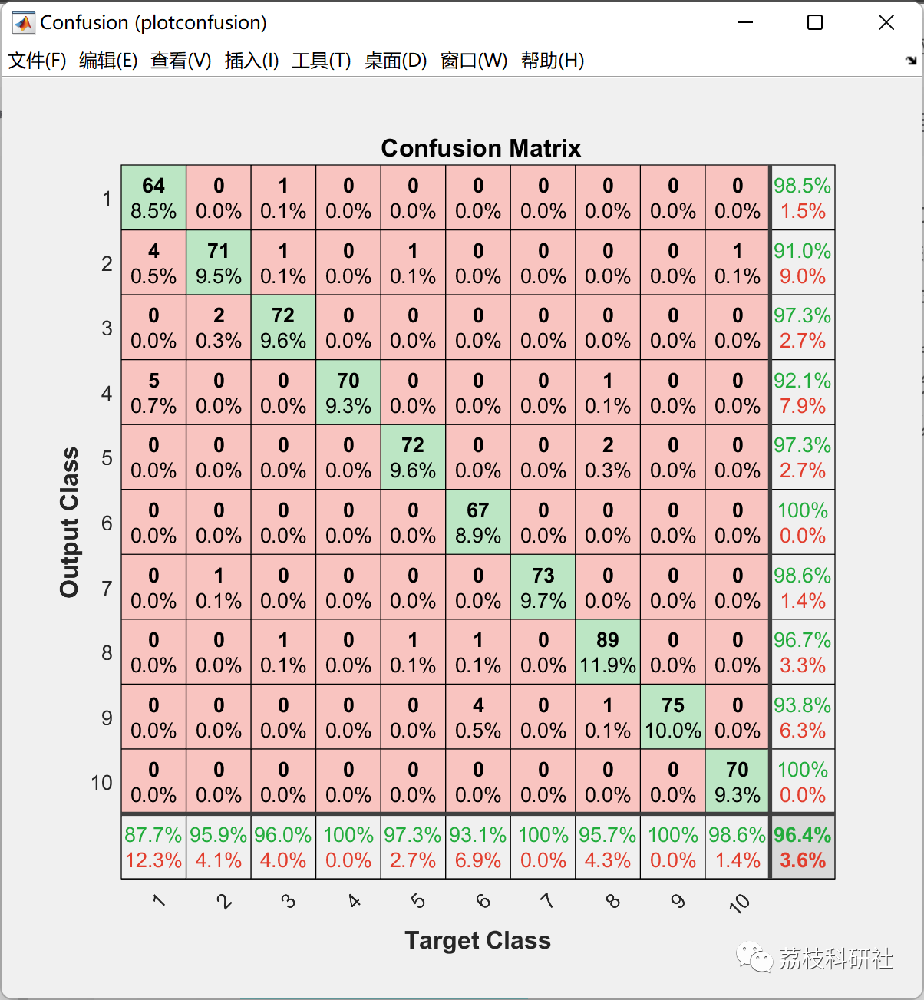
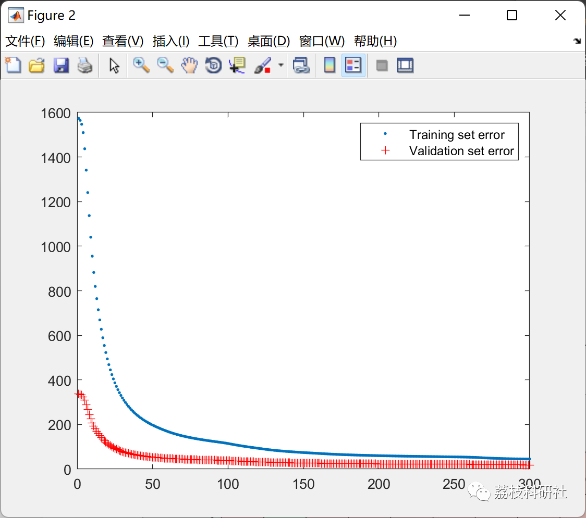

# Handwritten Digit Recognition Based on BP Neural Network (Matlab Code Implementation)

💥💥💥💞💞💞💞 Welcome to this blog❤️❤️❤️💥💥💥
🏆 Bloggers' Advantage: 🌞🌞🌞 The content of the blog strives to be rigorous in thought and clear in logic, for the convenience of readers.
⛳️ Mantra: The journey of a hundred miles is half done in the last ninety.
Litchi Research Society
Code Collection: Power System, Intelligent Algorithms and Applications, Neural Network Prediction, Path Planning, Optimized Scheduling, Workshop Scheduling, Image Processing, Signal Processing...
🎁Column Directory Link:
🌈🌈🌈🌟🌟🌟Electrical Code Intelligent Algorithm and Its Application Path Planning Neural Network Predictive Optimization Scheduling Image Processing Workshop Scheduling Signal Processing Romantic Her My Philosophical Thoughts Math Modeling Complete Code Matters
Contents
💥1 Overview
📚2 Running Results
🎉3 References
🌈4 Matlab code implementation
💥1 Overview
Under the influence of artificial intelligence, machine learning and deep learning have also rekindled a new wave. Currently, artificial intelligence encompasses four main areas: speech recognition, natural language processing, computer vision, and machine learning [1,2]. Among them, machine learning is one of the fastest-growing branches of artificial intelligence.
The development of computer technology and network technology has led to the need for a significant amount of digital information to be collected into computers before processing. For example, postal codes on letters, digit information on various bank receipts, student ID numbers on exam papers, and the entry of handwritten courier notes in the logistics industry can all be recognized using handwriting recognition technology, thereby enhancing efficiency and saving manpower. The methods of handwritten digit recognition can be roughly divided into three categories based on their principles: statistical feature classification, structural feature classification, and neural network-based algorithms. The author mainly implements the BP neural network in the field of handwritten digit recognition.
📚2 Running Results
🎉3 References
[1] Xu Peng. Handwritten Digit Recognition Based on BP Neural Network [J]. Science and Technology Vision, 2020(11):51-53. DOI:10.19694/j.cnki.issn2095-2457.2020.11.019.
🌈4 Matlab Code Implementation
Click the left bottom corner of the article to read in full.

## Images

<!-- PAYMENT_BLOCK -->

## Get this dataset

- Payment link (Stripe): [Buy now](https://buy.stripe.com/3cs8yP7sY87d0vu9AB)
- Payment QR code: 

<!-- /PAYMENT_BLOCK -->
